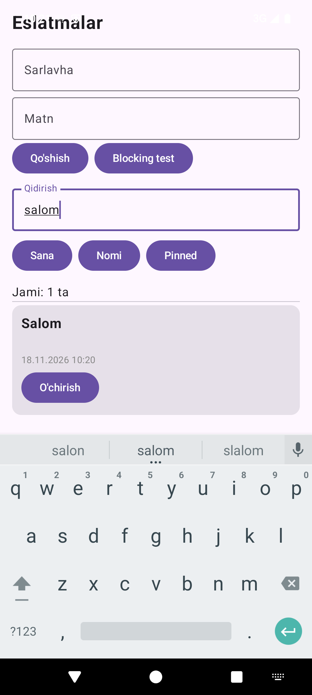

# RoomNotes

Laboratoriya 8 uchun eslatmalar ilovasi. Room bilan baza, Compose bilan ekran, 29-savol uchun Retrofit ham bor.

Savollarga javoblar `NOTES.md` da.

## Ishga tushirish

Android Studio da papkani ochib Run bosiladi. Buyruq satridan:

```bash
./gradlew installDebug
```

Testlar:

```bash
./gradlew test
```

```bash
./gradlew connectedAndroidTest
```

Birinchisiga emulator kerak emas, ikkinchisiga kerak.

## Baza tuzilishi

```
notebook                     note                          tag
+----+------+                +-------------+               +----+------+
| id | name |                | id          |               | id | name |
+----+------+                | title       |               +----+------+
     |                       | content     |                    |
     | 1                     | created_at  |                    |
     |                       | pinned      |                    |
     |                       | priority    |                    |
     |                       | tags        |                    |
     +------- ko'p --------->| notebookId  |                    |
        (FK, CASCADE)        +-------------+                    |
                                    |                           |
                                    |      note_tag             |
                                    |   +--------+-------+      |
                                    +-->| noteId | tagId |<-----+
                                        +--------+-------+
                                     (ikkalasi birga primary key)

user                      contact
+----+-------+-----------+   +----+------+--------+------+-------------+-----------+
| id | login | avatarUrl |   | id | name | street | city | work_street | work_city |
+----+-------+-----------+   +----+------+--------+------+-------------+-----------+
 GitHub keshi                 @Embedded prefix misoli
```

Aloqalar:
- bitta `notebook` da ko'p `note` bor, daftar o'chsa eslatmalari ham o'chadi (CASCADE);
- `note` va `tag` ko'pga-ko'p, orasida `note_tag` jadvali;
- `user` alohida turadi, u faqat internetdan olingan ma'lumotning keshi.

## Papkalar

```
data/      entity, DAO, converter, migratsiya, AppDatabase
network/   Retrofit servis, UserEntity kesh, repository
ui/        ViewModel, Compose ekrani, MainActivity
app/schemas/   eksport qilingan schema fayllari (1.json ... 4.json)
docs/      skrinshotlar
```

## Baza versiyalari

| versiya | nima o'zgardi | qanday |
|---|---|---|
| 1 | boshlang'ich holat | |
| 2 | `priority` qo'shildi | qo'lda, `MIGRATION_1_2` |
| 3 | `body` nomi `content` bo'ldi | `@AutoMigration` + `@RenameColumn` |
| 4 | `is_archived` olib tashlandi | qo'lda, jadvalni qayta yasash |

## Ekran


